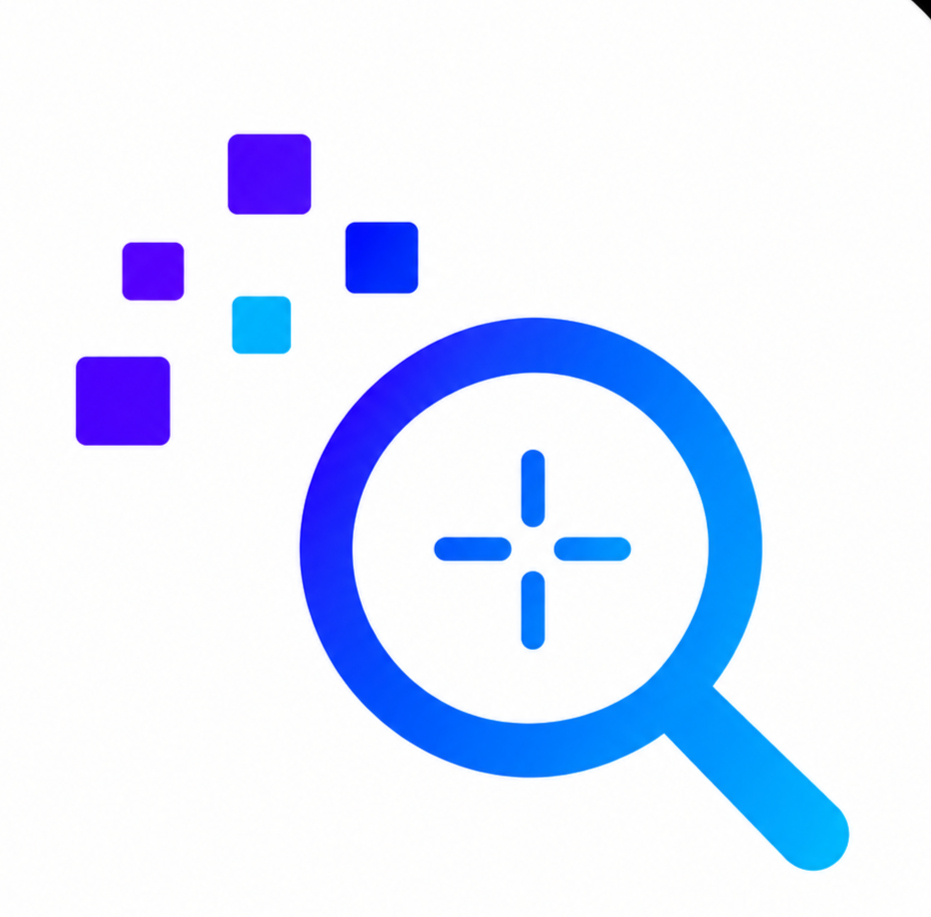

<div align="center">

  

  # StegoScope

  ### Image Steganalysis & Digital Forensics

  **Inspect · Analyze · Detect · Extract**

  A local-first forensic toolkit for examining PNG and BMP images for statistical indicators of hidden data.

  <p>
    
    
    
    
  </p>

  <a href="#quick-start">Quick Start</a> ·
  <a href="#features">Features</a> ·
  <a href="#detection-methods">Detection Methods</a> ·
  <a href="#documentation">Documentation</a>

</div>

---

## Overview

**StegoScope** is an offline image-steganalysis and digital-forensics application. It examines supported image files for statistical patterns that may be associated with Least Significant Bit (LSB) replacement steganography.

The application combines three analysis techniques—LSB statistics, Chi-Square analysis, and RS analysis—into a transparent suspicion score and a human-readable verdict. It also provides candidate payload extraction, LSB-plane visualization, batch scanning, image cleaning, and report generation.

StegoScope includes both a **PySide6 desktop interface** and a **command-line interface (CLI)**. Image analysis is performed locally; the application does not require cloud processing or upload images to a remote service.

> **Forensic caution:** Steganalysis is probabilistic. A suspicious result is not proof that a payload exists, and a CLEAN result does not prove that an image contains no hidden data.

## Features

| Area | Capabilities |
|---|---|
| Image inspection | Load and inspect supported PNG and BMP images |
| LSB analysis | Examine least-significant-bit distributions, means, runs, and channel imbalance |
| Chi-Square analysis | Apply the Westfeld–Pfitzmann statistical approach |
| RS analysis | Apply the Regular/Singular (RS) analysis method |
| Verdict engine | Combine detector findings into a 0–100 suspicion score, verdict, confidence note, and explanatory reasons |
| Payload inspector | Extract candidate LSB payload bytes for safe examination |
| LSB visualization | Export channel LSB planes as black-and-white PNG images |
| Image cleaner | Neutralize selected LSB planes and remove image metadata |
| Batch scanner | Scan directories, optionally recursively, and rank results |
| Reports | Generate TXT, JSON, CSV, and PDF reports |
| Desktop application | Navigate analysis tools through a PySide6 GUI with light and dark themes |
| CLI | Run individual scans and batch jobs from a terminal |
| Local-first operation | Process images on the local machine without remote image uploads |

## Detection methods

StegoScope's current detection pipeline focuses on indicators associated with **LSB replacement**.

### 1. LSB statistics

Examines the least-significant bit of each supported channel and calculates statistics such as:

- Number and percentage of zero and one bits
- LSB mean
- Longest run of equal bits
- Imbalance between channel LSB means

A distribution close to 50/50 can be consistent with random embedded data, but it can also occur naturally. LSB balance is therefore treated as a weak signal rather than standalone proof.

### 2. Chi-Square analysis

Uses the **Westfeld–Pfitzmann** approach to examine pairs of adjacent pixel values. Random LSB replacement tends to balance the counts within value pairs. StegoScope calculates a Chi-Square statistic and uses the resulting p-value as its embedding-probability indicator.

### 3. RS analysis

Uses the **Fridrich–Goljan–Du** Regular/Singular analysis approach. It compares image smoothness classifications under positive and negative flipping masks and evaluates the resulting imbalance.

### Verdict and score

The verdict engine combines detector and channel findings into a suspicion score from **0 to 100** and one of three labels:

- `CLEAN`
- `SUSPICIOUS`
- `LIKELY HIDDEN DATA`

The report includes the reasons behind the score, per-channel findings, and a confidence caveat. Results should always be interpreted in the context of the image and the limitations of the detection methods.

### Known detection limitations

The current pipeline is not a universal steganography detector. Detection is not guaranteed for:

- LSB matching (±1 embedding)
- Adaptive or model-based steganography
- F5 and J-UNIWARD
- Payloads or embedding patterns outside the assumptions of the implemented statistical methods

The Chi-Square method has additional limitations for small payloads, payloads beginning partway through an image, and some channel-specific or encrypted-payload scenarios. RS estimates can also be unreliable on some image content.

## Supported image formats

| Format | Status |
|---|---|
| PNG | Supported |
| BMP | Supported |
| JPEG | Not supported |
| WebP | Not supported |

Supported image modes include `L`, `LA`, `RGB`, `RGBA`, and palette (`P`) images. Modes that would require a potentially destructive conversion are rejected rather than silently normalized. In particular, 16-bit and other unsupported image modes may be refused to preserve the original LSB representation.

## Installation

StegoScope is distributed in the GitHub repository as a release archive named **`StegoScope-v1.zip`**. The archive contains the platform-specific installers and the canonical `app/` source directory.

### 1. Download the project

Clone the repository:

```bash
git clone https://github.com/silent-days/StegoScope.git
cd StegoScope
```

Extract the release archive from the repository:

```bash
unzip StegoScope-v1.zip
```

This creates a `StegoScope/` folder containing the application and the `Linux/`, `Windows/`, and `macOS/` installer folders.

Alternatively, open the [GitHub repository](https://github.com/silent-days/StegoScope), download `StegoScope-v1.zip`, and extract it. Then open the extracted `StegoScope` folder.

### 2. Install on your operating system

Choose **one** installer that matches your operating system. Run it from the extracted release folder.

#### Linux (Kali, Ubuntu, Debian and other distributions)

Open a terminal and run:

```bash
cd StegoScope/Linux
bash install.sh
```

To use the graphical installer instead:

```bash
cd StegoScope/Linux
bash install-gui.sh
```

When installation is complete, launch the application:

```bash
bash run.sh
```

The installer creates a private Python environment at `StegoScope/app/.venv`, installs the application dependencies, and adds a StegoScope desktop-menu entry.

**Linux troubleshooting:** On Debian-based systems, if Python virtual-environment support is missing, install it with:

```bash
sudo apt update
sudo apt install -y python3-venv python3-pip
```

If the GUI reports missing OpenGL/EGL libraries, install:

```bash
sudo apt install -y libegl1 libgl1
```

#### Windows 10 / 11

1. Open the extracted `StegoScope` folder.
2. Open the `Windows` folder.
3. Double-click `install-gui.bat` for the graphical installer.

Alternatively, open Command Prompt in the `Windows` folder and run:

```bat
install.bat
```

After installation, launch the application with:

```bat
run.bat
```

Make sure Python 3.11 or newer is installed and that **Add Python to PATH** was enabled during installation.

#### macOS

Open Terminal and run:

```bash
cd StegoScope/macOS
bash install-macos.sh
```

Launch the application with:

```bash
bash run.sh
```

You can also double-click `StegoScope.command` from the macOS folder.

### 3. Verify the installation

The installers create an isolated environment inside the release's `app/` directory. To verify the CLI installation, open a terminal in the extracted `StegoScope/app` folder.

Linux / macOS:

```bash
.venv/bin/stegoscope version
```

Windows:

```bat
.venv\Scripts\stegoscope.exe version
```

To open the desktop application, use the platform launcher (`run.sh` or `run.bat`) described above.

### Requirements

- Python **3.11 or newer**
- Linux, Windows 10/11, or macOS
- Internet access during installation to download Python dependencies

StegoScope installs its Python dependencies into a project-specific virtual environment. It does not need to install packages into the system Python environment.

### Uninstallation

Use the uninstaller in the matching platform folder:

- **Linux:** `StegoScope/Linux/uninstall.sh`
- **Windows:** `StegoScope/Windows/uninstall.bat`

On macOS, remove the installed application environment and launcher using the project files/instructions supplied with the release.

The Linux and Windows uninstallers remove the private virtual environment and launcher support while preserving the application source. Keep the extracted project folder if you want to retain the source code, samples, and reports.

For more details, see [`docs/INSTALL.md`](StegoScope/docs/INSTALL.md) and [`docs/TROUBLESHOOTING.md`](StegoScope/docs/TROUBLESHOOTING.md) inside the extracted release.

---

## Command-line usage

After installation, run CLI commands from the `app/` directory. The examples below use the Linux/macOS virtual-environment executable; on Windows, use `.venv\Scripts\stegoscope.exe`.

### Check the version

```bash
.venv/bin/stegoscope version
```

### Scan an image

```bash
.venv/bin/stegoscope scan samples/embedded_text.png
```

### Save a report

The report format is inferred from the output file extension:

```bash
.venv/bin/stegoscope scan samples/embedded_text.png \
  --report reports/scan.json
```

Supported report extensions are `.txt`, `.json`, `.csv`, and `.pdf`.

### Extract candidate payload data

```bash
.venv/bin/stegoscope scan samples/embedded_text.png --extract
```

To write candidate bytes to a file:

```bash
.venv/bin/stegoscope scan samples/embedded_text.png \
  --payload-out reports/candidate.bin
```

Extracted bytes are untrusted candidate data. Inspect them safely; do not execute them.

### Export LSB planes

```bash
.venv/bin/stegoscope scan samples/embedded_text.png \
  --lsb-planes reports/lsb-planes/
```

### Batch scan a directory

```bash
.venv/bin/stegoscope batch samples/ \
  --recursive \
  --output reports/batch-results
```

Batch output can include CSV and JSON results. For all available options:

```bash
.venv/bin/stegoscope --help
.venv/bin/stegoscope scan --help
.venv/bin/stegoscope batch --help
```

The `stegoscan` command is also provided as an entry point for the CLI.

## Desktop interface

The GUI organizes the forensic workflow into the following areas:

- Dashboard
- Image Analysis
- LSB Analysis
- Chi-Square Analysis
- RS Analysis
- Payload Inspector
- Image Cleaner
- Batch Scanner
- Visual Forensics
- Reports
- Settings
- About

The interface includes light and dark themes. The GUI can be started using the platform launcher after installation.

## Reports and output

StegoScope can generate:

- **TXT** — readable analysis summaries
- **JSON** — structured analysis data
- **CSV** — tabular analysis and batch results
- **PDF** — formatted forensic reports

Reports are intended to support documentation and further investigation. Preserve original evidence and record the context in which each image was obtained.

## Security and privacy

StegoScope is designed to process untrusted image input locally.

Implemented safeguards documented by the project include:

- File-size and decoded-pixel limits to reduce resource-exhaustion risk
- Refusal of truncated and unsupported image inputs
- Per-file error isolation during batch scanning
- Bounded candidate-payload extraction
- Output overwrite protection unless `--force` is supplied
- Traversal-safe naming for per-image batch reports
- Extracted bytes treated as untrusted data and never automatically executed
- Source images left unchanged by analysis

The Image Cleaner is intentionally destructive to selected image data: neutralizing LSB planes can destroy hidden payload information. Work on a copy and retain the original image.

For implementation details, see [`StegoScope/app/docs/SECURITY.md`](StegoScope/app/docs/SECURITY.md) in the release package.

## Testing

The project includes automated tests for image loading, LSB statistics, Chi-Square analysis, RS analysis, verdict scoring, payload extraction, image cleaning, batch scanning, CLI behavior, and report generation.

Run the test suite from the `app/` directory after installing the development dependencies:

```bash
python -m pytest tests/ -v
```

For headless Linux environments:

```bash
QT_QPA_PLATFORM=offscreen python -m pytest tests/
```

The project's testing report records **144 passing tests** in its tested environment, with a GUI-related test skipped where the sandbox lacked the required system graphics library. Its detection metrics use synthetic, controlled samples; they should not be interpreted as a real-world accuracy guarantee.

## Project layout

The GitHub repository distributes the application as `StegoScope-v1.zip`. After extracting that release archive, the project layout is:

```text
StegoScope/
├── Linux/                  # Linux installers, launcher, uninstaller
├── Windows/                # Windows installers, launcher, uninstaller
├── macOS/                  # macOS installer and launcher
├── docs/
│   ├── INSTALL.md
│   └── TROUBLESHOOTING.md
└── app/                    # Canonical application source
    ├── stegoscope/
    │   ├── analysis/        # LSB, Chi-Square, RS analysis
    │   ├── core/            # Image loading, verdicts, batch, cleaner
    │   ├── extraction/     # Candidate payload extraction
    │   ├── reporting/      # TXT, JSON, CSV, PDF reports
    │   ├── visualization/  # Visual analysis and plots
    │   ├── cli/             # Command-line interface
    │   ├── gui/             # PySide6 desktop interface
    │   └── assets/          # Application assets and icons
    ├── tests/
    ├── samples/
    ├── reports/
    ├── docs/
    ├── main.py
    ├── pyproject.toml
    ├── requirements.txt
    └── requirements.lock.txt
```

**Keep the `app/` directory intact.** It contains the canonical application source used by the platform installers.

## Documentation

Additional documentation is included in the extracted release:

| Document | Description |
|---|---|
| [`docs/INSTALL.md`](StegoScope/docs/INSTALL.md) | Installation walkthrough |
| [`docs/TROUBLESHOOTING.md`](StegoScope/docs/TROUBLESHOOTING.md) | Common installation and launch issues |
| [`app/docs/DETECTION_METHODOLOGY.md`](StegoScope/app/docs/DETECTION_METHODOLOGY.md) | Technical details of the detection pipeline |
| [`app/docs/SECURITY.md`](StegoScope/app/docs/SECURITY.md) | Security model and safeguards |
| [`app/docs/TESTING.md`](StegoScope/app/docs/TESTING.md) | Test coverage and limitations |
| [`app/CONTRIBUTING.md`](StegoScope/app/CONTRIBUTING.md) | Development and contribution guidance |
| [`app/CHANGELOG.md`](StegoScope/app/CHANGELOG.md) | Project change history |

## Contributing

Bug reports, improvements, and pull requests are welcome.

Before submitting a change:

1. Describe the behavior being changed.
2. Add or update regression tests where appropriate.
3. Run the test suite.
4. Keep CLI behavior and report formats compatible where possible.
5. Update the detection-methodology documentation when changing detector logic or thresholds.

See [`app/CONTRIBUTING.md`](StegoScope/app/CONTRIBUTING.md) for the development workflow and project-specific guidelines.

## License

StegoScope is distributed under the **MIT License**. See the [`LICENSE`](LICENSE) file for the full license text.

---

<div align="center">

  **StegoScope**

  *Explore the hidden layer of digital images.*

  <a href="https://github.com/silent-days/StegoScope">Repository</a>

</div>
